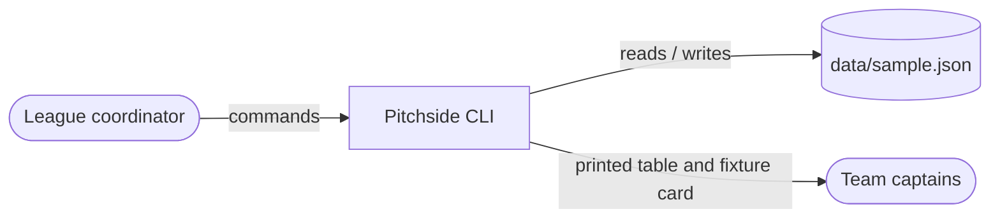
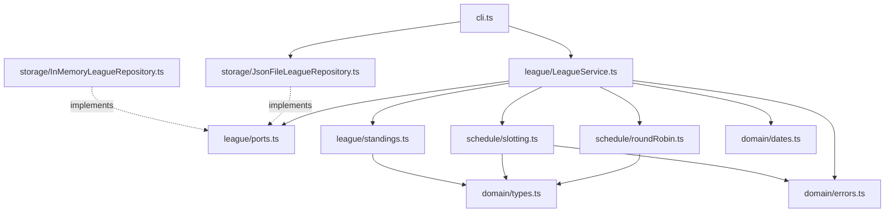

# Pitchside — design sketch

Handover notes from the developer who started this. Matter-of-fact; the code is the
authority where the two disagree, but tell me if they do.

## Context

Pitchside is a command-line tool for the Campus Recreation coordinator at Cascadia
Community College. It replaces a spreadsheet. One person uses it, at a desk or a laptop
courtside, a few times a week during the quarter. Team captains never touch it; they see
a printout or a pasted table.

In scope: one league, one division, a single round-robin, two courts, a handful of
match nights, results and forfeits, standings with the league's tiebreakers. Out of
scope: multiple leagues or divisions, player rosters, referees, a web page, notifications,
anything that needs a network.

## Components

- `domain/` — the entity types (plain readonly objects), the one `DomainError` class and
  its codes, the date helpers, and the default settings. No logic beyond parsing dates.
- `schedule/roundRobin.ts` — pure. Team ids in, rounds of pairings (plus a bye for odd
  counts) out. Circle method.
- `schedule/slotting.ts` — pure. Rounds plus settings in, fixtures with court and
  kick-off out. Fills match nights in order.
- `league/standings.ts` — pure. League in, sorted table out. Tally first, then the
  comparator with the tiebreakers.
- `league/LeagueService.ts` — the only thing that changes state. Every method loads from
  the repository, builds a new `League` value and saves it. It takes a `Clock` so the
  "has this match finished" rule is testable.
- `league/ports.ts` — the `LeagueRepository` interface and the `Clock` type.
- `storage/` — two repositories: in-memory for tests, JSON file for the CLI. The JSON
  file is exactly a serialised `League`; there is no migration story yet.
- `cli.ts` — argument parsing by hand, one function per command, plain `console.log`
  tables. Excluded from coverage on purpose; it has no logic worth testing on its own.

## Key rules

These are canon. Issues cite them by number.

- **R1** A single round-robin: every team plays every other team exactly once.
- **R2** With an odd number of teams each round has one bye; every team gets at most one bye.
- **R3** Rounds are assigned to match nights in order; a round's fixtures fill courts × slots on that night, earliest slot and court A first; a round that does not fit in what is left of a night moves whole to the next night.
- **R4** Home/away alternates for each team as far as the circle method allows. This is best effort, not a guarantee (see limitations).
- **R5** Win 3, draw 1, loss 0. A forfeit is recorded as 0–3 against the forfeiting team and counts as a played match.
- **R6** Standings order: points, then goal difference, then goals for, then the head-to-head result between the tied teams (only when exactly two teams are tied on all three), then team name.
- **R7** A fixture has at most one result; recording again replaces it. Standings are derived from results every time and are never stored.
- **R8** A result cannot be recorded until the fixture's slot has ended (slot start plus `matchMinutes`), by the injected clock.
- **R9** Teams cannot be added after the schedule has been generated.

## Decisions

- [ADR 0001](docs/adr/0001-standings-are-derived-not-stored.md) — Standings are derived from results on every read, never stored.

## Known limitations

- Home/away balance (R4) is claimed, not measured. The orientation rule in
  `roundRobin.ts` was written by reasoning about the circle method, and nobody has
  checked the split on a real schedule.
- `LeagueSettings` is a plain object read directly by `slotting.ts` and `standings.ts`.
  A `ScoringPolicy` / `Tiebreaker[]` abstraction was considered and left out to keep the
  first version small; the schedule generator is likewise a single hard-coded function,
  so a different format (double round-robin, playoffs) means changing the service.
- The standings comparator is one long function. The head-to-head lookup walks every
  result on every comparison, which is fine for ten teams and wrong in principle.
- Slot strings ('2026-11-18T19:00') are built in `slotting.ts` and taken apart again in
  `cli.ts` by hand; `domain/dates.ts` only covers parsing and adding minutes.
- There is no way to move a fixture to another night once the schedule is generated,
  and no way to remove a team. Both have been asked for.
- The JSON file has no version field. Changing the `League` shape means editing the
  sample by hand.

## Where to start reading

1. `src/domain/types.ts` — ten minutes, and everything else refers to it.
2. `src/league/LeagueService.ts` top to bottom; it is the story of the system.
3. `tests/LeagueService.test.ts` and `tests/support.ts` for how to set up a league in a test.
4. `src/schedule/roundRobin.ts` only when you need to touch scheduling; the comment at
   the top explains the circle method.
